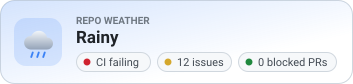

# Repo Weather


Une GitHub Action qui transforme l'état de ton dépôt en bulletin météo, sous forme de badge SVG à afficher dans ton README.

 

 

Le badge suit le thème clair ou sombre de GitHub. Les icônes sont légèrement animées (soleil qui tourne, pluie qui tombe, éclairs), sauf si le lecteur a demandé à réduire les animations.

| Thème sombre forcé (`theme: dark`) | Statique, en anglais (`animated: false`, `lang: en`) |
| --- | --- |
|  |  |

Le style `pill` donne une pastille de 28 px, à placer à côté d'un titre ou dans une rangée de badges :

  

## Comment la météo est calculée

La condition la plus grave l'emporte :

| Météo | Condition |
| --- | --- |
| Orageux | Au moins une PR bloquée |
| Pluvieux | La CI échoue sur la branche par défaut |
| Nuageux | Il reste des issues ouvertes (au-delà de `issues-threshold`) |
| Ensoleillé | Tout va bien |

- **CI** : pour chaque workflow, le dernier run terminé sur la branche par défaut. Les runs annulés ou ignorés ne comptent pas, et le workflow qui génère le badge ne se juge pas lui-même.
- **PR bloquée** : une PR ouverte, hors brouillon, qui est en conflit, qui a reçu une demande de modifications, ou qui n'a pas bougé depuis `stale-days` jours.

## Utilisation

Crée `.github/workflows/weather.yml` :

```yaml
name: Météo du dépôt

on:
  schedule:
    - cron: '0 */6 * * *'
  issues:
    types: [opened, closed, reopened]
  workflow_run:
    workflows: [Tests] # le nom de ton workflow de CI
    types: [completed]
  workflow_dispatch:

permissions:
  contents: write
  actions: read
  issues: read
  pull-requests: read

concurrency:
  group: repo-weather

jobs:
  weather:
    runs-on: ubuntu-latest
    steps:
      - uses: Kaysuto/repo-weather@v1
```

Puis ajoute le badge à ton README :

```markdown

```

L'Action committe le badge seulement quand il change, avec `[skip ci]` dans le message.

GitHub met les images en cache : si le badge semble en retard après un run, ajoute un paramètre à l'URL pour forcer le rechargement (`.github/repo-weather.svg?v=2`).

### Une image par thème

Pour choisir toi-même l'image affichée en mode clair et en mode sombre, génère deux badges avec `theme: light` et `theme: dark`, puis utilise les suffixes de GitHub :

```markdown


```

## Paramètres

| Nom | Défaut | Description |
| --- | --- | --- |
| `token` | `github.token` | Jeton utilisé pour lire le dépôt et committer le badge |
| `repo` | le dépôt courant | Dépôt décrit par le badge (`propriétaire/nom`) |
| `path` | `.github/repo-weather.svg` | Chemin du badge dans le dépôt |
| `style` | `card` | `card` pour la carte complète, `pill` pour une pastille de 28 px |
| `messages` | — | Raisons personnalisées, une ligne par météo (voir ci-dessous) |
| `stale-days` | `14` | Jours sans activité avant qu'une PR compte comme bloquée |
| `issues-threshold` | `0` | Issues ouvertes tolérées avant le temps nuageux |
| `lang` | `fr` | Langue du badge : `fr` ou `en` |
| `theme` | `auto` | `auto` suit le thème du lecteur, `light` ou `dark` le forcent |
| `animated` | `true` | `false` pour un SVG sans animation |
| `commit` | `true` | `false` pour seulement écrire le fichier (à publier toi-même) |
| `commit-message` | selon la météo | Message du commit du badge |
| `branch` | branche par défaut | Branche où committer le badge |

Sorties : `weather` (`sunny`, `cloudy`, `rainy`, `stormy`), `phrase` (bulletin en une ligne, par exemple « Orageux : 2 PR bloquées »), `path` et `changed` (`true` si le badge a été committé).

### Messages personnalisés

La raison affichée par la pastille et la sortie `phrase` peuvent être remplacées, météo par météo. `{issues}`, `{blocked}` et `{ci}` sont remplacés par les valeurs du dépôt :

```yaml
      - uses: Kaysuto/repo-weather@v1
        with:
          style: pill
          messages: |
            stormy: {blocked} PR à débloquer
            cloudy: {issues} issues à trier
```

### Météo d'un autre dépôt

Avec `repo: propriétaire/nom`, le badge décrit un autre dépôt mais reste committé dans celui qui exécute le workflow. Pour un dépôt privé, passe un jeton personnel dans `token` : le jeton par défaut ne peut lire que les dépôts publics et le tien.

## Versions

| Référence | Signification |
| --- | --- |
| `@v1` | Dernière version 1.x : ce tag avance à chaque nouvelle version |
| `@v1.1.1` | Cette version précise. Un tag de version n'est déplacé que pour réparer une version inutilisable |
| `@<sha du commit>` | La seule référence vraiment immuable, celle que GitHub recommande pour les workflows sensibles |

Ce cas est arrivé une fois : `v1.1.0` a été republiée le 30 octobre 2026, quelques minutes après sa sortie, parce que son `action.yml` était invalide et que l'Action ne démarrait pas.

Les changements de chaque version sont listés dans les [releases](https://github.com/Kaysuto/repo-weather/releases).

## Limites

- Seules les 100 PR ouvertes les plus récentes sont examinées.
- Si la branche par défaut est protégée, le jeton par défaut ne peut pas y committer : utilise `branch` pour viser une autre branche, ou `commit: false` et publie le fichier toi-même.

## Développement

Aucune dépendance, Node 24 suffit :

```bash
npm test
```

Les badges de `examples/` servent de référence : les tests vérifient que le rendu leur est identique octet par octet. Après une modification volontaire du design, régénère-les :

```bash
npm run examples
```

## Licence

[MIT](LICENSE)
